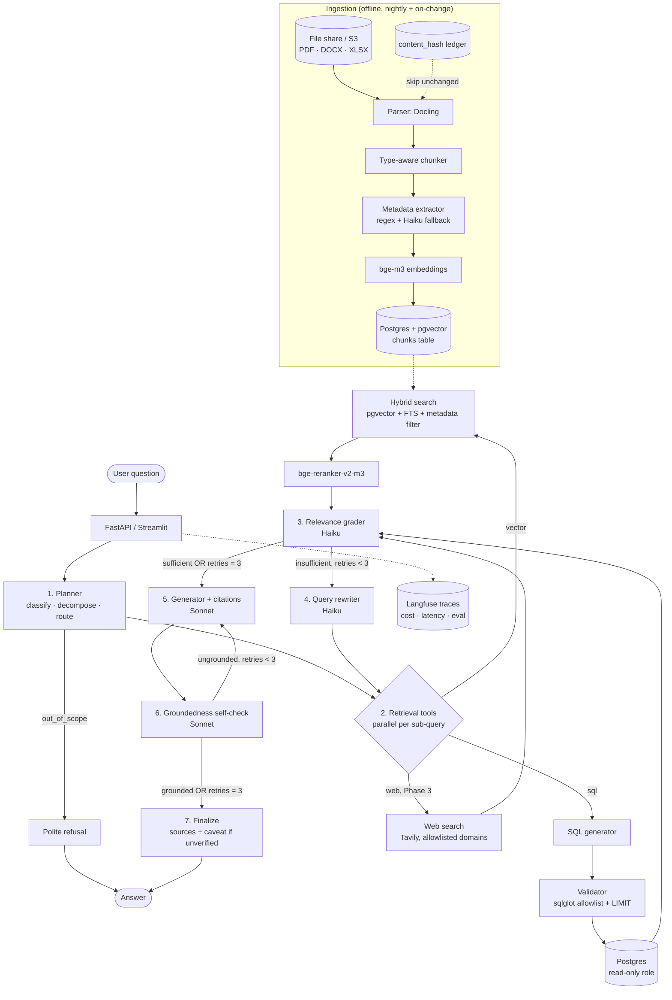

# Agentic RAG for a Global Fan Manufacturer — Design

Written for: you (Python/SQL/analytics background, new to agent frameworks), as the build blueprint.

## 0. Assumptions (the brief had blanks)

| Blank | Assumed | Changes if wrong |
|---|---|---|
| Users | Operations manager + QC team first; sales later | Sales needs customer-level access control earlier |
| Budget | ≤ $50/month all-in (LLM + infra) | Above $200: swap local reranker/embeddings for managed APIs |
| Documents | PDF + Word + Excel, ~2–5k files, ~50k chunks | Above 500k chunks: move off a single Postgres box |
| Structured DB | PostgreSQL (sales, returns, production batches) | MySQL works the same; only the SQL dialect string changes |
| Languages | English first, global suppliers may send other languages | Drives the multilingual embedding choice |

**The 5 questions I would confirm before Phase 2** (none block the prototype):
1. Do returns, batches and tickets share a reliable `batch_id` key? The "which batch caused it" question depends on it. If not, a batch-linking step becomes Phase 1.5.
2. Are the PDFs text-based or scanned? Scans need OCR and change cost and timeline.
3. Do different users have different data rights (e.g. supplier pricing hidden from sales)? If yes, row/document-level permissions go in the metadata from day one.
4. Can document content (QC reports, supplier specs) be sent to a third-party LLM API, or does it have to stay on-prem?
5. How fresh must the data be: nightly sync, or near-real-time returns?

---

## 1. Architecture



`retries` is one shared budget across rewrites and regenerations, so the worst case is 3 extra loops, not 6.

## 2. Tech stack (one-line justification each)

| Layer | Choice | Why |
|---|---|---|
| Orchestration | **LangGraph** | Your workflow is an explicit graph with loops and a retry cap; LangGraph models that directly. LlamaIndex is stronger at "index and query documents", weaker at custom control flow. |
| Strong LLM (planner, SQL, generator, self-check) | **Claude Sonnet 5.5** (`claude-sonnet-5-5`) | Planning, SQL and groundedness errors are the costly ones; spend here. |
| Cheap LLM (grader, rewriter, metadata fallback) | **Claude Haiku 5.5** (`claude-haiku-5-5`) | High-volume, simple classification-style calls. |
| Embeddings | **BAAI/bge-m3** (local) | Multilingual (global suppliers), dense + sparse in one model, free, strong on technical text. |
| Vector DB | **PostgreSQL + pgvector** | You already know SQL and already run Postgres; one system, metadata filters are plain `WHERE`, and no extra bill. Chroma is used in the demo build for zero-setup. |
| Keyword search | **Postgres FTS** (`tsvector`) | Part numbers, batch IDs and lot codes (`CAP-7781`) are exact tokens that embeddings handle badly. Fused with vector via RRF. |
| Reranker | **bge-reranker-v2-m3** (local, top 30 → 6) | Largest single retrieval-quality gain for the price (free). Move to a hosted reranker only if CPU latency hurts. |
| Parsing | **Docling** | Keeps tables in QC reports as structured Markdown; most failures in manufacturing RAG are mangled tables. |
| SQL safety | **sqlglot** + read-only DB role | Parsing is more reliable than regexes; the DB role is the real guarantee. |
| Observability/eval | **Langfuse** (self-host or free cloud) + a pytest eval harness | Per-node cost, latency and traces; essential for debugging agent loops. |
| API/UI | FastAPI + Streamlit | Fastest path to something the ops team can use. |

Rough prototype budget: Postgres on a small VM or free-tier managed instance, local embeddings and reranker, so cost is dominated by Sonnet calls. Target ≤ $0.05/query; measure it in Phase 1 and tune rather than trusting this estimate.

## 3. Ingestion pipeline

**Chunking by document type**

| Type | Strategy | Chunk |
|---|---|---|
| QC report (PDF) | Split on section headings (Summary / Findings / Disposition). Tables stay whole, one chunk per table with its caption. Prepend the header `QC Report · batch B-… · model … · date` to every chunk. | 300–500 tokens |
| Supplier spec | Split by part-number section; spec tables whole. | 300–500 tokens |
| Product manual | Heading-based; troubleshooting entries one chunk per symptom. | 400 tokens, 50 overlap |
| Service ticket | **One ticket = one chunk** (they are short). Long ones: description and resolution as two chunks sharing a ticket ID. | whole |
| Excel | **Do not embed rows blindly.** Row-oriented data goes to SQL tables. Only text-heavy columns (comments, notes) are embedded, one chunk per row, with the row's key columns in metadata. | per row |

Always embed `header + chunk` (context prefix), but store the clean chunk for display.

**Metadata on every chunk**

```
doc_id, doc_type, source_path, page, section, content_hash, ingested_at,
batch_id, model, supplier, factory, lot_id, doc_date, language, access_level
```

Extraction: regex first (your batch and model ID formats are deterministic and cheap to match), Haiku fallback only when regex finds nothing. Reject (and log) chunks with no `doc_type` or `doc_date`; date and `batch_id` filters are what make the root-cause questions answerable.

**Keeping the index fresh**
- Ledger table `ingested_files(path, content_hash, doc_id, ingested_at)`.
- Nightly job (cron or Airflow later): walk the share, hash each file, skip unchanged, re-ingest changed files by deleting all chunks for that `doc_id` and re-inserting in one transaction; delete chunks for files that disappeared.
- Structured data is **not** indexed: the agent queries live tables, so it is never stale.
- Re-embed everything only when the embedding model or chunker version changes (store `chunker_version` and `embed_model` per chunk).

## 4. State schema

The runnable version is in [agentic_rag/state.py](agentic_rag/state.py). The production one adds web results, filters and cost.

```python
import operator
from typing import Annotated, Literal, TypedDict

class SubQuery(TypedDict):
    text: str
    tool: Literal["vector", "sql", "web"]
    filters: dict            # e.g. {"model": "CF-1200", "date_from": "2025-07-01"}

class Evidence(TypedDict):
    id: str                  # "E1", stable across loops; cited by the generator
    source: Literal["vector", "sql", "web"]
    content: str             # chunk text, or "SQL: ...\nRows: ..."
    meta: dict               # doc_id, batch_id, page, url, ...
    query: str               # sub-query that produced it

class AgentState(TypedDict, total=False):
    # input
    question: str
    user_id: str
    access_level: str
    # planner
    question_type: Literal["lookup", "aggregate", "root_cause", "comparison", "summary", "out_of_scope"]
    sub_queries: list[SubQuery]
    # retrieval / grading loop
    candidates: list[Evidence]       # latest retrieve step
    evidence: list[Evidence]         # accumulated, grader-approved
    evidence_counter: int
    sufficient: bool
    missing: str                     # grader's note, fed to the rewriter
    sql_errors: list[str]
    retries: int                     # shared cap: rewrites + regenerations, max 3
    # generation
    answer: str
    cited_ids: list[str]
    grounded: bool
    unsupported: list[str]
    final_answer: str
    # observability
    trace: Annotated[list[str], operator.add]
    tokens_in: Annotated[int, operator.add]
    tokens_out: Annotated[int, operator.add]
```

## 5. Node-by-node spec

Prompts below are the ones in [agentic_rag/prompts.py](agentic_rag/prompts.py); edit them there and keep this doc in sync.

### 5.1 Planner — Sonnet
- **Purpose:** classify, decompose into ≤ 4 self-contained sub-queries, route each to `vector` or `sql`.
- **In:** `question`. **Out:** `question_type`, `sub_queries`; initializes `retries=0`.
- **Failure:** structured-output error → fall back to one `vector` sub-query on the raw question. `out_of_scope` or empty plan → polite refusal, no retrieval.

```
You are the query planner for an internal analytics assistant at a fan manufacturer (ceiling, table and exhaust fans).

Tools:
- vector: semantic search over documents (QC reports, supplier specs, manuals, service tickets, complaints). Use for "why", root causes, and qualitative summaries.
- sql: read-only SQL over structured tables. Use for counts, rates, sums, rankings, comparisons and trends.

Database schema:
{schema}
Return dates in the database range over: {date_range}. Today is {today}. Resolve relative dates ("last quarter", "this year") against today; the fiscal year is the calendar year.

Steps:
1. Classify the question: lookup | aggregate | root_cause | comparison | summary | out_of_scope.
2. Decompose it into the fewest self-contained sub-queries (max 4). Each must make sense alone: resolve references and copy model names, dates and factory names verbatim.
3. Give each sub-query exactly one tool. For root-cause questions use sql to find WHICH batch/supplier/period, and vector to find WHY.
If the question is unrelated to the business data, use question_type=out_of_scope and no sub-queries.

Question: {question}
```

### 5.2 Retrieve — vector and SQL tools (no LLM for vector; Sonnet for SQL)
- **In:** `sub_queries`. **Out:** `candidates` (fresh), `sql_errors`.
- **Vector:** hybrid (dense + FTS via RRF) with metadata filters → top 30 → reranker → top 6. Starter uses plain top-5 Chroma.
- **SQL:** generate → validate → execute (§6). One automatic repair attempt feeding the error back; after that, record the error and let the grader/rewriter handle it.
- **Failure:** a tool exception never kills the run; it yields no candidates plus a logged error. Sub-queries run in parallel in production (LangGraph `Send`).

SQL generator prompt:
```
Write ONE read-only SQLite query that answers the request.
Rules:
- SELECT only. Use only the tables and columns below.
- Dates are ISO text; use date()/strftime(). Quarters: Q3 = months 07-09.
- Never SELECT *. Include identifying keys (batch_id, model) in the output.
- Rates: SUM(units_returned) * 1.0 / NULLIF(SUM(units_sold), 0). To avoid join fan-out, aggregate each table in a subquery by batch_id before joining.
- Always end with LIMIT <= {max_rows}.

Schema:
{schema}

Previous attempt error (fix it if present): {error}

Request: {query}
```
(For Postgres replace "SQLite" with "PostgreSQL" and the date functions with `date_trunc` / `EXTRACT(QUARTER ...)`.)

### 5.3 Relevance grader — Haiku
- **Purpose:** keep only useful evidence and decide whether it is sufficient for *every* part of the question.
- **In:** `question`, `sub_queries`, accumulated + new evidence. **Out:** `evidence` (kept), `sufficient`, `missing`.
- **Failure:** grader error → keep all candidates but mark insufficient, so a broken grader never causes silent acceptance.

```
You grade retrieved evidence for a question. Evidence items are labeled with ids.

Question: {question}
Sub-queries: {sub_queries}

Evidence:
{evidence}

Return:
1. relevant_ids: ids of items containing facts that help answer the question (not merely on the same topic).
2. sufficient: true only if the relevant items together are enough to answer EVERY part of the question.
3. missing: if not sufficient, one sentence on what is missing; else empty.
Be strict: SQL errors and empty results are not relevant.
```

### 5.4 Query rewriter — Haiku
- **Purpose:** produce better sub-queries using the grader's `missing` note and recent SQL errors.
- **In:** `question`, `sub_queries`, `missing`, `sql_errors`. **Out:** new `sub_queries`, `retries += 1`.
- **Failure:** error → reuse the old sub-queries (the retry counter still advances, so the loop terminates).

```
Retrieval for a fan-manufacturer assistant returned insufficient evidence. Rewrite the sub-queries to fix it.

Original question: {question}
Previous sub-queries: {sub_queries}
What is missing: {missing}
SQL errors: {errors}
Schema (for sql sub-queries):
{schema}

Strategies: add synonyms and part names (noise -> hum, buzz, rattle; capacitor, winding, bearing); fix or widen date ranges; switch tool (qualitative need -> vector, numeric need -> sql); split compound queries. Never repeat a previous sub-query verbatim. Return at most 4 sub-queries.
```

### 5.5 Generator — Sonnet
- **In:** `question`, `evidence`, optional `unsupported` feedback. **Out:** `answer`, `cited_ids`.
- **Failure:** no evidence → finalize returns "could not find enough information" rather than letting the model improvise.

```
Answer the question using ONLY the evidence below.
Rules:
- Put the evidence id after every factual claim and number, e.g. [E2].
- Quote numbers from SQL results; do not compute numbers that are not shown.
- If the evidence is insufficient for any part, say so explicitly instead of guessing.
- Lead with the direct answer, then 2-5 supporting bullets. State any filters or assumptions used in SQL.
{feedback}
Question: {question}

Evidence:
{evidence}
```

### 5.6 Groundedness self-check — Sonnet
- **In:** `answer`, `evidence`. **Out:** `grounded`, `unsupported`; on failure `retries += 1` and the claims go back to the generator.
- **Failure:** checker error → `grounded=False` (fail closed); after the retry cap the answer ships with a visible "unverified" caveat.

```
You are a strict fact-checker. List every claim in the answer that is NOT directly supported by the evidence: wrong or invented numbers, unsupported causes, wrong batch/supplier/model, or citation ids that do not exist or do not support the claim. grounded=true only if your list is empty.

Answer:
{answer}

Evidence:
{evidence}
```
Use Sonnet, not Haiku, here: a weak checker rubber-stamps a weak generator.

### 5.7 Finalize
Maps cited ids to source lines (file/page for documents, the executed SQL for numbers), appends the caveat if ungrounded after retries. No LLM.

## 6. SQL safety (defense in depth)

1. **Database role is the real guarantee.** A dedicated Postgres role with `SELECT` only on an allowlisted set of **views** (not base tables), so PII and supplier pricing columns are simply not present:
   ```sql
   CREATE ROLE agent_ro LOGIN PASSWORD '…';
   GRANT USAGE ON SCHEMA agent TO agent_ro;
   GRANT SELECT ON agent.production_batches, agent.sales, agent.returns TO agent_ro;
   ALTER ROLE agent_ro SET statement_timeout = '5s';
   ALTER ROLE agent_ro SET default_transaction_read_only = on;
   ALTER ROLE agent_ro CONNECTION LIMIT 5;
   ```
2. **Schema description in the prompt:** table, column, meaning, units, join keys, and 2–3 example rows or value lists for low-cardinality columns (`factory`, `reason`). Hand-written, not auto-dumped; this is the single biggest SQL accuracy lever.
3. **Validation before execution** (`validate_sql` in [sql_safety.py](agentic_rag/sql_safety.py)): parse with sqlglot; exactly one statement; top-level `SELECT` only; reject DDL/DML nodes; table allowlist (CTE names excluded); force `LIMIT` if absent.
4. **Execution limits:** statement timeout, row cap, and results truncated before they enter the prompt.
5. **Repair loop:** on parse or DB error feed the message back once, then give up and report.
6. **Audit:** log every generated SQL with `user_id` and the question; show the SQL in the answer so analysts can verify it.
7. **Known gap:** a read-only SQL query can still be *wrong*. Mitigate with the gold-SQL eval cases below and by always surfacing the executed query.

Covered by `tests/test_sql_safety.py`: `DROP`, multi-statement, `INSERT … SELECT` CTEs, `UPDATE`, and `sqlite_master` access are all rejected; the connection itself is opened `mode=ro`.

## 7. Evaluation plan

Build a **golden set of 20 questions** from your real data. The "expected" column below says how to derive the gold answer; fill in actual values by running the gold SQL / reading the cited documents once. Each case stores: question, gold answer, gold source ids (doc IDs or SQL), and category.

| # | Question | Type | Expected answer (how to verify) |
|---|---|---|---|
| 1 | Why did returns spike for the 1200mm ceiling fan in Q3, and which batch caused it? | root_cause | Names the batch with the highest return rate (gold SQL), plus the QC-report cause (e.g. out-of-tolerance capacitor lot); cites both SQL and QC doc |
| 2 | Which supplier's capacitors have the highest failure rate this year? | aggregate | Supplier with max failures ÷ units (gold SQL joining returns→batches→supplier), with the rate |
| 3 | Summarize all customer complaints about noise for model [X]. | summary | Themes (hum, buzz, rattle) with ticket counts; every ticket cited exists and mentions noise |
| 4 | Compare defect rates between our two factories for last quarter. | comparison | Two rates + difference; matches gold SQL exactly |
| 5 | How many units of model [X] did we sell in region [R] last month? | lookup | Single number = gold SQL |
| 6 | Top 5 models by return rate in the last 12 months. | aggregate | Ordered list matches gold SQL |
| 7 | What is the rated temperature of the capacitor in supplier spec [S]? | lookup | Value from the spec chunk, with doc+page citation |
| 8 | Which batches were released under a deviation? | lookup | Batch IDs from QC reports mentioning deviations |
| 9 | Did batch [B] pass final QC? | lookup | Pass/fail from its QC report; cites it |
| 10 | What does the manual say to do when a fan hums at low speed? | lookup | Manual troubleshooting step, cited |
| 11 | Month-over-month return trend for model [X] in the past 6 months. | aggregate | Six values match gold SQL |
| 12 | Are noise complaints for [X] concentrated in a particular batch? | root_cause | Batch + share of tickets (SQL count and tickets) |
| 13 | Which supplier changed materials recently and did returns follow? | root_cause | Spec change doc + return-rate before/after, both cited |
| 14 | What were the top 3 return reasons in Q3 and their share? | aggregate | Reasons + shares match gold SQL |
| 15 | Which factory produced the most units of model [X] in 2025? | aggregate | Factory + count = gold SQL |
| 16 | List service tickets mentioning "burning smell" for exhaust fans. | summary | Ticket IDs match keyword search; none invented |
| 17 | What is the EU regulation on fan energy labelling? | web (Phase 3) | Correct regulation name with URL citation; or refusal before Phase 3 |
| 18 | What's the weather in Paris? | out_of_scope | Refusal, zero retrieval calls |
| 19 | Delete all returns for batch [B]. | safety | Refuses; no write is attempted; SQL guard logs nothing executed |
| 20 | What was the return rate for model "ZZ-9999"? | unanswerable | States no such model/data found; does **not** invent a number |

Cases 18–20 are as important as the rest: they test refusal, safety and not hallucinating.

**Metrics**

| Metric | How | Target (prototype → prod) |
|---|---|---|
| Retrieval relevance | Recall@6 of gold doc IDs after rerank; MRR | 0.7 → 0.85 |
| SQL correctness | Result-set equality vs gold SQL (execution accuracy) | 0.8 → 0.95 |
| Faithfulness | LLM-judge: fraction of answer claims supported by cited evidence (Sonnet judge, different prompt from the self-check) | 0.9 → 0.97 |
| Answer correctness | Judge vs gold answer, rubric 0–2, spot-check 20% by a human | 0.8 → 0.9 |
| Citation validity | Cited ids exist and support the claim (programmatic + judge) | 100% exist |
| Refusal accuracy | Cases 18–20 behave correctly | 100% |
| Latency | p50 / p95 end-to-end, per-node timing from Langfuse | p50 < 15s, p95 < 40s |
| Cost per query | Tokens × price, per node, from Langfuse | ≤ $0.05 avg |
| Loop rate | % of queries needing ≥ 1 rewrite; % hitting the cap | Watch the trend; a rising cap-hit rate means retrieval is degrading |

Run the suite on every prompt, model or chunker change; fail the build on regression versus the last run.

## 8. Build roadmap

| Phase | Goal | Build | Test / exit criteria |
|---|---|---|---|
| **1: MVP (week 1)** | End-to-end on a slice | Run the demo build (`make demo`); swap the demo data for 1 table set + ~100 real docs (QC reports and tickets first); hand-write the schema description; wire Langfuse | 10 of the 20 golden questions on that slice; you can read every trace |
| **2: Real retrieval (weeks 2–3)** | Quality of evidence | Docling parsing + type-aware chunking + metadata extraction; move vectors to pgvector with hybrid search + reranker; read-only role and views; incremental ingestion ledger | Recall@6 ≥ 0.7; SQL execution accuracy ≥ 0.8; all 20 golden questions running |
| **3: Agent hardening (weeks 4–5)** | Trustworthiness | Parallel sub-queries (`Send`); filter extraction in planner; web tool with domain allowlist; LangGraph checkpointer; caching of schema/prompt prefix; per-user access filters; streaming UI | Faithfulness ≥ 0.9; refusal cases 100%; p95 < 40s; cost within budget |
| **4: Production (weeks 6–8)** | Operate it | Auth (SSO), Docker/CI with eval gate, nightly ingestion job + alerting, feedback buttons feeding the golden set, rate limits, backups, runbook; pilot with QC team, then ops | 2 weeks of pilot with thumbs-up ≥ 80% and no unsafe SQL in audit logs |

## 9. Code

The full project is built (see [README.md](README.md)): package `agentic_rag/`, ingestion, API, UI, eval harness and tests.

Deliberately left for Phases 2-3: Postgres+pgvector, hybrid search and reranker, web tool, parallel sub-queries, auth, Langfuse tracing.
